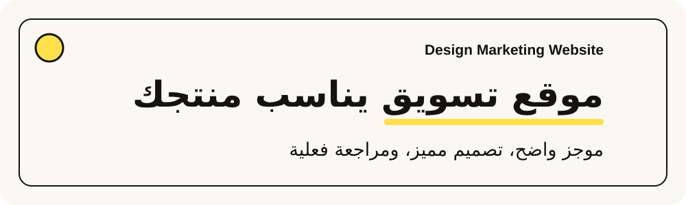
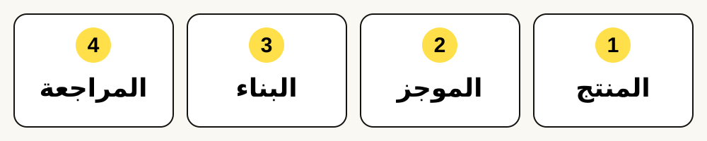
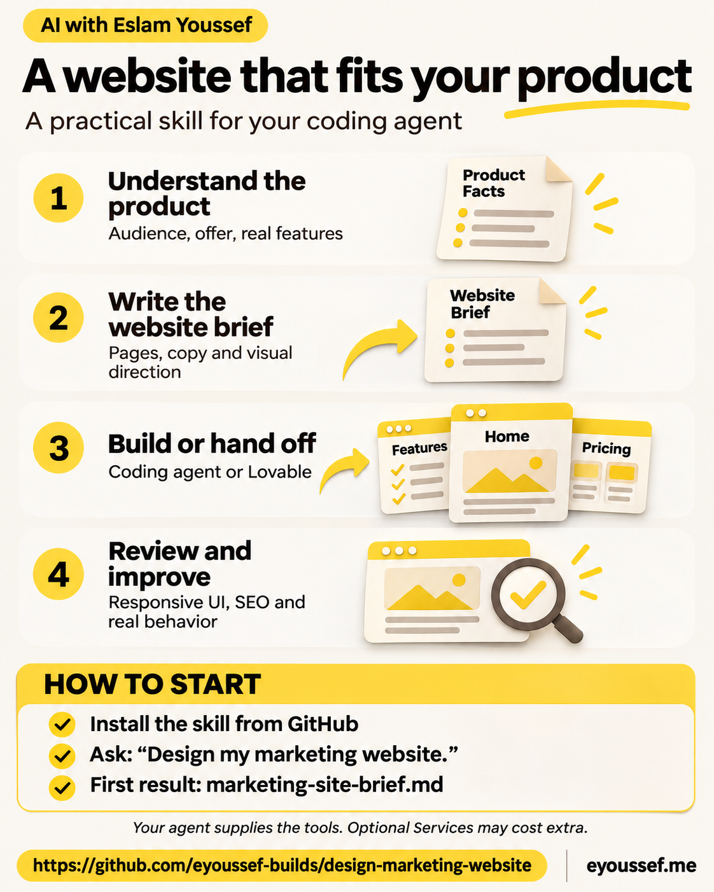
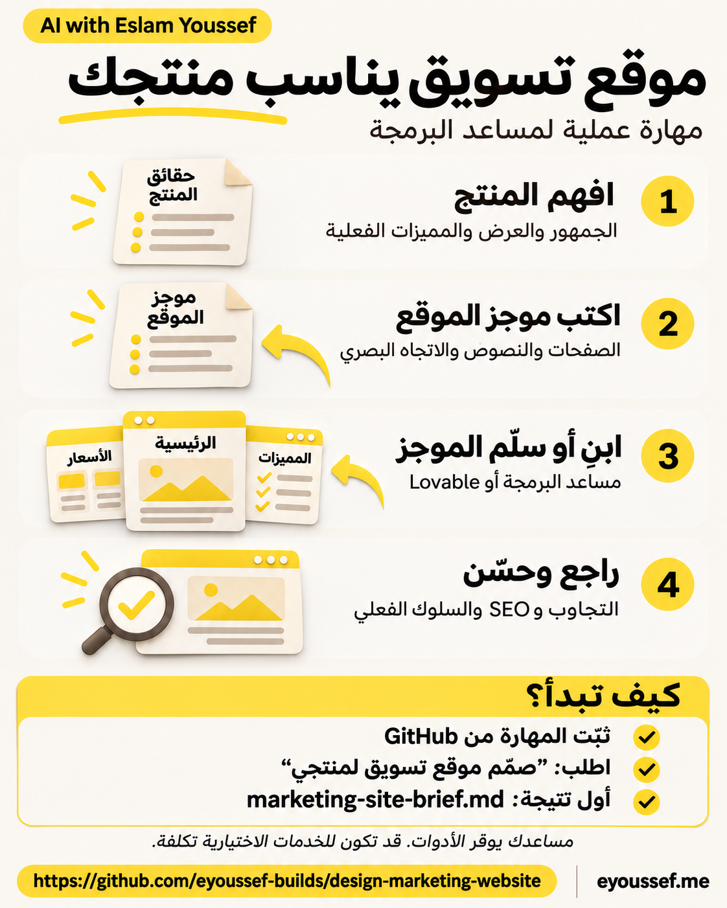
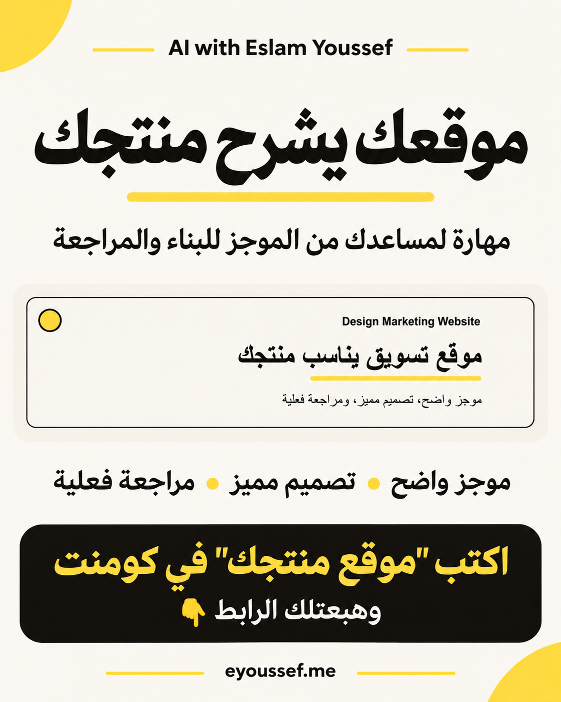

<div dir="rtl">

<p align="center"></p>

<p align="center"><a href="README.md"><b>Read in English</b></a> · <a href="#install">التثبيت</a> · <a href="#first-use">أول تجربة</a> · <a href="#questions">أسئلة</a> · <a href="#share">المشاركة</a></p>

<p align="center"><a href="LICENSE"></a> <a href="docs/agent-installation.ar.md"></a> </p>

## 👋 منتجك يستحق موقعًا يشبهه

عندك منتج وتريد تعريف الناس به. تطلب من مساعد الذكاء الاصطناعي موقعًا، فيعطيك صفحة جميلة لكنها تصلح لأي مشروع: صفحات ناقصة، أزرار بلا نتيجة واضحة، أو كلام يعد بمميزات لم تطلقها بعد.

**Design Marketing Website تعطي مساعدك طريقة عملية لتخطيط موقع تسويق عام وبنائه ومراجعته حول منتجك الحقيقي.** تناسب المؤسسين والمستقلين وفرق المنتجات والوكالات، سواء كان المنتج SaaS أو خدمة أو أداة أو عرضًا آخر.

1. **يفهم المنتج:** من يساعده، وما الذي يقدمه، وما المتاح الآن.
2. **يكتب موجز الموقع:** صفحات مفيدة، ونصوص فعلية، واتجاه بصري مميز وتفاعلات واضحة.
3. **يبني أو يجهّز التسليم:** بمساعد البرمجة، أو بالموجز نفسه لأداة مثل Lovable.
4. **يراجع النتيجة:** يفحص الصفحات والإجراءات والموبايل ومتطلبات الظهور، ثم يصلح المشاكل ويعيد فحصها.

<p align="center"></p>

**المهارة** مجلد تعليمات وقوالب لمساعدك. ليست قالب موقع أو خدمة استضافة أو تطبيق بناء مستقلًا. المساعد يوفّر أدوات التنفيذ، والمهارة تنظّم طريقة العمل.

### ماذا تستلم؟

| ما تحتاجه | ما يجهّزه أو ينفّذه المساعد |
| --- | --- |
| خطة موقع واضحة | ملف `marketing-site-brief.md` مستقل مرتبط بتعريف المنتج |
| موقع يتجاوز صفحة عامة | خريطة صفحات، لكل صفحة سؤال زائر ومحتوى مفيد يخصها |
| شخصية بصرية مناسبة | اتجاه فني وخطوط ومسافات وأصول ومكونات مرتبطة بالمنتج |
| بناء الموقع | تنفيذ وفق بنية المشروع عندما تطلبه وتتوفر أدواته |
| التسليم لأداة أخرى | موجز منقح قابل للنقل مع المدخلات التي تحتاجها الأداة فعلًا |
| تجربة متجاوبة | فحوص الموبايل والكمبيوتر ولوحة المفاتيح واللغة وRTL حسب الحاجة |
| متطلبات الظهور | بيانات وصفية لكل صفحة ومحتوى قابل للزحف وروابط canonical وخريطة موقع وJSON-LD مناسب |
| محتوى يظل دقيقًا | مقطع لقواعد المشروع لمراجعة الصفحات المتأثرة مع تغييرات المنتج المعتمدة |
| تسليم صادق | توضيح ما تم تخطيطه وبناؤه وتسليمه ونشره وفحصه فعلًا |

لا تفرض إطار عمل أو عدد صفحات أو ألوانًا ثابتة أو مهارة تصميم خارجية. هوية منتجك المعتمدة هي المرجع. ترتيب البحث والنتائج المحسنة ومطابقة إمكانية الوصول وتحسن الأداء تحتاج دليلًا؛ لا تضمنها المهارة.

<a id="install"></a>

## 📥 ثبّتها بخطوات صغيرة

**تحتاج:** مساعدًا يقرأ الملفات. البناء يحتاج ملفات المشروع وأدواته، والفحص البصري يحتاج متصفحًا. قد تكون للمساعد والنموذج والاستضافة وأداة البناء تكاليف منفصلة.

### الأسهل: اطلب من المساعد

1. افتح جلسة تسمح بتنزيل الملفات وحفظها.
2. أرسل:

   ```text
   ثبّت design-marketing-website من
   https://github.com/eyoussef-builds/design-marketing-website.
   اقرأ README وافحص المهارة أولًا. ثبّت مجلد skills/design-marketing-website
   كاملًا في مكان المهارات الشخصية المدعوم لديك. حافظ على أي نسخة معدّلة،
   ثم وضّح لي طريقة الاستدعاء.
   ```

3. اقرأ أي طلب إذن من المساعد للتنزيل أو حفظ الملفات.
4. اسأل: **«هل ترى design-marketing-website؟ ماذا تحتاج لإعداد موجز موقعي؟»**

### تفضّل النسخ بنفسك؟

1. [حمّل ZIP المستودع](https://github.com/eyoussef-builds/design-marketing-website/archive/refs/heads/main.zip).
2. فك الضغط: انقر مرتين على الماك، أو بالزر الأيمن ثم **Extract All…** على Windows.
3. افتح **skills** وستجد مجلد **design-marketing-website** كاملًا.
4. انسخه إلى المكان الموجود في [دليل مساعدك](docs/agent-installation.ar.md)، مع المراجع والقوالب.
5. أعد تحميل المهارات أو فتح المساعد عند الحاجة، ثم اطلبها بالاسم.

الدليل التفصيلي يغطي **15 مساعدًا**، مع الفصل بين دعم المجلدات الأصلي وقراءة التعليمات صراحة. يتضمن macOS/Linux وPowerShell وفحص ظهور المهارة والتحديث والحذف. مراجعة الوثائق ليست تجربة بناء موقع على كل المساعدين.

<a id="first-use"></a>

## 🚀 أول موقع لك

### 1. أعطه تعريف المنتج

افتح مشروع المنتج، ثم أرسل في Codex:

```text
استخدم $design-marketing-website. اقرأ تعريف المنتج المعتمد والموقع الموجود.
جهّز marketing-site-brief.md لموقع التسويق العام.
اقترح صفحات مفيدة واتجاهًا بصريًا مميزًا يناسب جمهورنا.
ضمّن التجاوب وإمكانية الوصول وSEO وJSON-LD المناسب وفحوص القبول.
اسأل عن القرارات المؤثرة الناقصة. جهّز الموجز أولًا؛ لا تبنِ أو تنشر الآن.
```

في Claude Code استخدم `/design-marketing-website`. ولغيره اتبع طريقة الاستدعاء الخاصة به أو [قراءة التعليمات صراحة](docs/agent-installation.ar.md).

ليس لديك `project.md`؟ أعطه الجمهور والعرض والمميزات المتاحة وهدف الموقع، أو وثيقة المنتج التي تستخدمها. يحافظ على اسمها ودورها بدل إنشاء مرجع منافس لها.

### 2. راجع الموجز

اقرأ الصفحات والنصوص المقترحة: هل تساعد الزائر؟ هل للأزرار وجهة فعلية؟ هل حالة المميزات دقيقة؟ وهل التصميم يناسب جمهورك؟

**مثال مخترع:** Harbor Tasks منتج افتراضي لتنظيم مهام فرق المستقلين الصغيرة. قد يقترح الموجز:

| الصفحة | ما يفهمه الزائر | الخطوة التالية |
| --- | --- | --- |
| `/` | هل يحل المنتج مشكلة تنسيق العمل؟ | استكشاف طريقة العمل |
| `/workflow` | كيف ينتقل المشروع من الموجز للتسليم؟ | مشاهدة مثال توضيحي معلّم |
| `/contact` | كيف يسأل عن الإتاحة؟ | استخدام وسيلة التواصل المتفق عليها |

إذا لم توجد خدمة متصلة، يُعلّم النموذج كتجربة؛ رسالة نجاح محلية لا تعني تسجيلًا حقيقيًا. شاهد [الموجز التوضيحي المخترع](docs/examples/marketing-site-brief.md).

### 3. اختر طريقة البناء

**بمساعد البرمجة:**

```text
نفّذ marketing-site-brief.md الذي راجعناه داخل بنية المستودع الحالية.
أكمل الصفحات والحالات المطلوبة ونفّذ المراجعة النهائية.
أبقِ النشر منفصلًا حتى أسمح به.
```

**بأداة خارجية:**

```text
جهّز نسخة منقحة من الموجز والأصول المطلوبة لتسليمها إلى Lovable.
وضّح ما أنقله فعلًا وأي تفاعلات تجريبية أو متصلة.
لا ترفع بيانات منتج خاصة أو تعد باستيراد غير مدعوم.
```

يمكن استخدام الموجز نفسه للطريقتين. [أدوات التصميم الاختيارية](skills/design-marketing-website/references/design-toolkit.md) قد تساعد في الاتجاه الفني أو المراجعة، لكنها ليست مطلوبة أو مضمّنة. مهارة التصميم ليست إطار عمل، وSaaS ليست Sass.

### 4. افحص النتيجة الفعلية

المراجعة النهائية إلزامية: تقارن النتيجة بالموجز والمراجع، وتفحص المسارات والإجراءات والموبايل والكمبيوتر ولوحة المفاتيح وRTL ودقة المحتوى والبيانات الوصفية والمنظمة. تُصلح المشاكل ويُعاد فحص الأجزاء المتأثرة.

لو طلبت موجزًا فقط، تراجع قابليته للتنفيذ دون ادعاء بناء موقع. ولو طلبت بناءً، تراجع الموقع الفعلي. نجاح البناء لا يثبت حفظ نموذج أو نشر موقع عام أو ترتيبًا في البحث.

### 5. حافظ على اتساق المنتج والموقع

اطلب دمج [مقطع قواعد الصيانة العربي](skills/design-marketing-website/assets/AGENTS-marketing-sync-snippet.ar.md) مع تعليمات مشروعك. عندما تعتمد تغييرًا في المنتج لاحقًا، يراجع المساعد الصفحات المتأثرة ويحدّثها ضمن العمل المأذون به.

هذه طريقة عمل داخل المشروع، وليست مراقبًا يعمل في الخلفية. لا تنشر الموقع تلقائيًا ولا تستبدل قواعد المشروع الأخرى.

## 🔒 الخصوصية ببساطة

شارك فقط حقائق المنتج اللازمة. أبقِ المفاتيح وبيانات العملاء والعمل غير المرتبط خارج الموجز والتسليم لأدوات أخرى. المساعد والنموذج وأي أداة بناء تعالج المدخلات التي تشاركها معها؛ لا ندّعي أن العمل كله دون اتصال. الحزمة العامة تعليمات وقوالب فارغة ومثال مخترع بوضوح. [دليل الخصوصية](docs/privacy.ar.md).

<a id="questions"></a>

## ❓ أسئلة وأجوبة

<details><summary><b>هل هي مجانية؟ وهل أستخدمها لعملائي؟</b></summary>

نعم، الحزمة مفتوحة المصدر برخصة MIT وتسمح بالاستخدام التجاري مع إبقاء إشعار الرخصة. للمساعد والنموذج وأدوات التصميم والبناء والاستضافة شروطها وتكاليفها الخاصة.

</details>

<details><summary><b>هل يجب استخدام Codex أو Lovable؟</b></summary>

لا يلزم مساعد أو أداة بناء بعينها. استخدم بيئة تقرأ التعليمات وتملك أدوات المهمة. المساعد الذي يعمل بالمحادثة فقط يساعد في التخطيط، لكنه لا يعدّل مستودعًا لا يصل إليه. Lovable مسار تسليم اختياري.

</details>

<details><summary><b>هل تنشئ دائمًا موقعًا متعدد الصفحات؟</b></summary>

تختار الصفحات التي يبررها المحتوى واحتياجات الزوار. قد تكفي صفحة قوية لعرض صغير، ويحتاج منتج آخر صفحات متعددة. تتجنب نسخ الصفحات لمجرد الكلمات المفتاحية.

</details>

<details><summary><b>هل تضمن جودة التصميم ونتائج SEO؟</b></summary>

تُلزم المساعد بتصميم مقصود ومراجعة فعلية وإصلاح وإعادة فحص، مع بقاء أهمية الحكم البشري. صحة JSON-LD أو إطار العمل أو llms.txt أو نتيجة المختبر لا تضمن ترتيبًا أو نتائج محسنة أو ظهورًا في إجابات AI.

</details>

<details><summary><b>هل توجد قوالب عربية؟</b></summary>

نعم، موجز الموقع ومقطع قواعد الصيانة متاحان بالعربية والإنجليزية. يتبع الموقع الذي تبنيه جمهوره ولغته وهويته، ولا يرث ألوان المواد الترويجية لهذا المستودع.

</details>

<details><summary><b>كيف أحدّثها أو أحذفها؟</b></summary>

قارن التنزيل الجديد بالمثبت واحفظ تعديلاتك. للحذف، أزل مجلد المهارة المثبّت فقط. موقعك والموجز وقواعد المشروع تبقى؛ راجع القواعد منفصلة إذا أردت إزالة مقطع الصيانة. راجع [دليل التثبيت](docs/agent-installation.ar.md).

</details>

<a id="share"></a>

## 🖼️ شارك طريقة العمل

[إنفوجرافيك إنجليزي](docs/images/infographic-en.png) · [إنفوجرافيك عربي](docs/images/infographic-ar.png) · [تصميم فيسبوك](docs/images/facebook-post-ar.png) · [نصوص السوشيال](docs/social-posts.ar.md) · [نصوص مشاركة باللغتين](docs/share.md)

<p align="center"><a href="docs/images/infographic-en.png"></a> <a href="docs/images/infographic-ar.png"></a></p>

<p align="center"><a href="docs/images/facebook-post-ar.png"></a></p>

## 🛠️ ماذا يوجد داخلها؟

```text
skills/design-marketing-website/
  SKILL.md       التخطيط والبناء والتسليم والمراجعة
  assets/        موجز وقواعد صيانة باللغتين
  references/    اختيار الأدوات وفحوص القبول والمراجعة
  agents/        بيانات Codex
docs/            أدلة ومثال مخترع ومواد مشاركة
```

الحزمة تعليمات فقط؛ لا تضم محرك موقع أو إضافة متصفح أو سكربت تثبيت أو مشغّل أدوات تصميم أو تكامل استضافة. تشير إلى موارد اختيارية دون إعادة توزيعها.

## 🤝 الدعم

[افتح بلاغًا](https://github.com/eyoussef-builds/design-marketing-website/issues) بالعربية أو الإنجليزية بمثال مخترع أو منقح، دون بيانات عملاء أو مفاتيح حقيقية.

**إعداد [eyoussef-builds](https://github.com/eyoussef-builds)** · [hello@eyoussef.me](mailto:hello@eyoussef.me) · [eyoussef.me](https://eyoussef.me) · [MIT](LICENSE)

</div>
