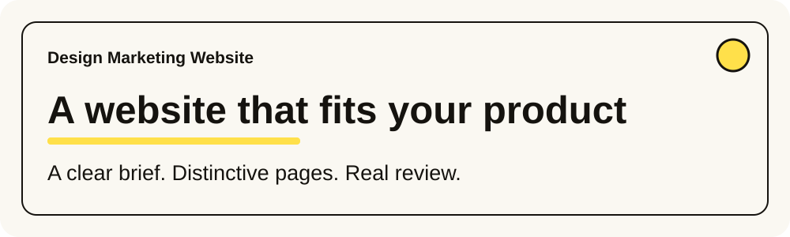
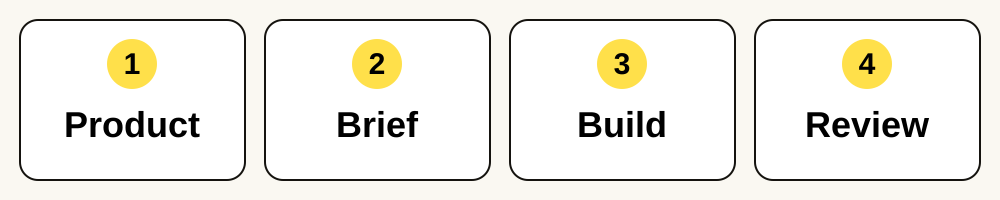
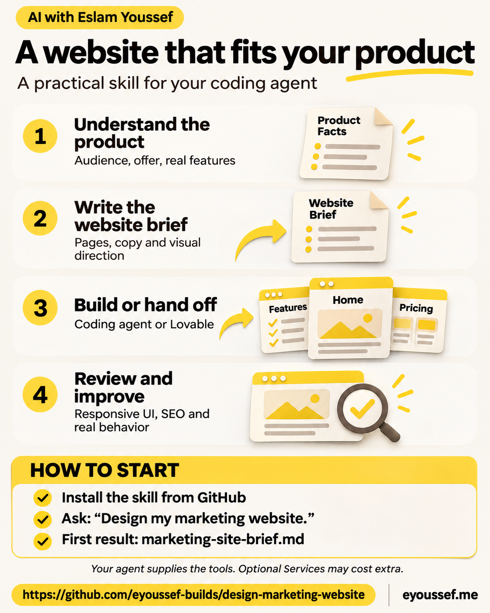
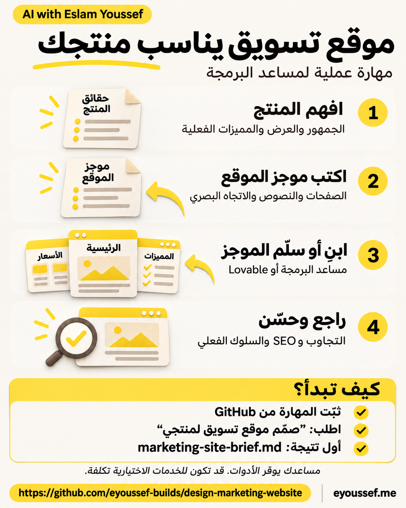
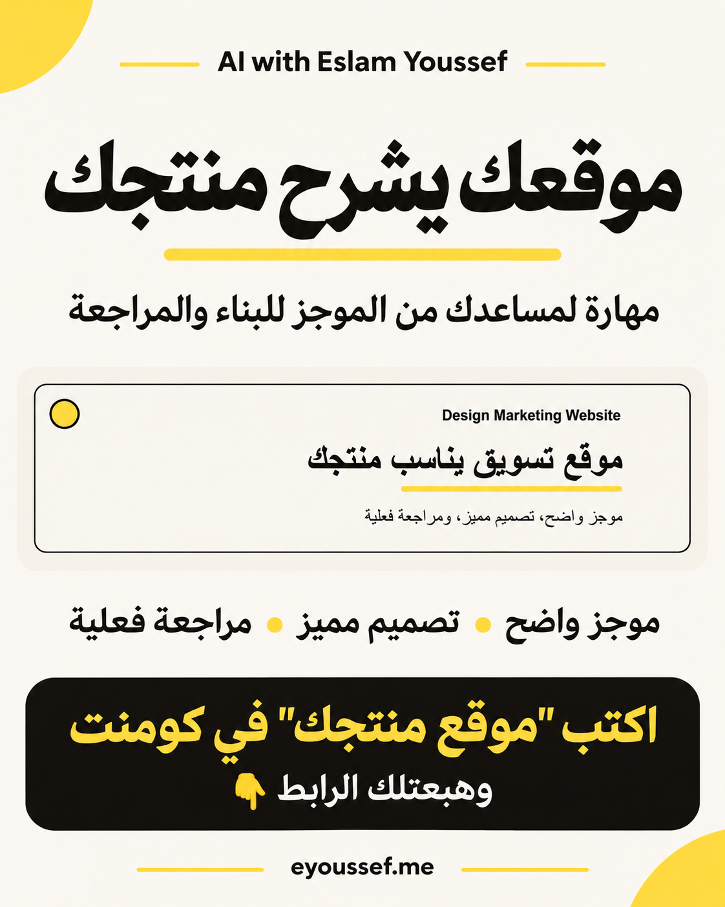

<p align="center"></p>

<p align="center"><a href="README.ar.md"><b>العربية</b></a> · <a href="#install">Install</a> · <a href="#first-use">First use</a> · <a href="#questions">Questions</a> · <a href="#share">Share</a></p>

<p align="center"><a href="LICENSE"></a> <a href="docs/agent-installation.md"></a> </p>

## 👋 Your product deserves its own website

You have a product to explain. You ask an AI agent for a website, and get a nice-looking page that could belong to almost any business. Important pages are missing, the buttons do little, and the copy promises features you have not released.

**Design Marketing Website gives your agent a practical way to plan, build and review a public website around your actual product.** It is useful for founders, freelancers, product teams and agencies working on SaaS, services, tools or other offers.

1. **Understand the product:** who it helps, what it offers and what is available now.
2. **Write the website brief:** meaningful pages, real copy, a distinctive visual direction and working interactions.
3. **Build or hand off:** use your coding agent, or transfer the same brief to a builder such as Lovable.
4. **Review the result:** inspect the actual pages, key actions, mobile layouts and discoverability; fix problems and recheck.

<p align="center"></p>

A **skill** is a folder of instructions and templates for your AI agent. This package is not a website theme, hosting service or autonomous website builder. Your agent brings the tools; the skill provides the workflow.

### What do you receive?

| You need | The agent prepares or does |
| --- | --- |
| A clear website plan | A separate `marketing-site-brief.md`, linked from your product definition |
| More than a generic landing page | A sitemap where each page answers a useful, distinct visitor question |
| A recognizable design | Product-specific art direction, typography, spacing, assets and components |
| A build | Implementation in the project's existing conventions, when requested and tools are available |
| A builder handoff | A sanitized, transferable brief with the inputs another tool actually needs |
| Responsive, accessible UI | Relevant mobile/desktop, keyboard, language and RTL checks |
| Discoverability | Page-specific metadata, crawlable content, canonicals, sitemap and suitable JSON-LD |
| Marketing that stays accurate | A project-instruction snippet to review affected pages alongside approved product changes |
| An honest handoff | What was briefed, built, handed off, deployed and actually checked |

It does not force a framework, a fixed page count, a particular palette or an optional third-party design skill. Your product's approved brand wins. Search rankings, rich results, accessibility conformance and performance gains require evidence; the skill does not guarantee them.

<a id="install"></a>

## 📥 Install it in a few small steps

**You need:** an agent that can read files. Building requires access to your project and its runtime. Visual checks need a browser. External builders, models, hosting and optional tools can have separate costs.

### Easiest: ask your agent

1. Open your agent in a session that can download and save files.
2. Copy this message:

   ```text
   Install design-marketing-website from
   https://github.com/eyoussef-builds/design-marketing-website.
   Read the README and inspect the skill first. Install the complete folder
   skills/design-marketing-website in your supported personal skill directory.
   Preserve an existing customized copy. Tell me how to invoke it.
   ```

3. Read any file/download permission prompt from your agent.
4. Ask: **“Can you see design-marketing-website? What do you need to prepare my website brief?”**

### Prefer to copy the folder yourself?

1. [Download the repository ZIP](https://github.com/eyoussef-builds/design-marketing-website/archive/refs/heads/main.zip).
2. Unzip it: double-click on Mac; on Windows, right-click and choose **Extract All…**.
3. Open **skills**. Find the complete **design-marketing-website** folder.
4. Copy that folder to the location in [your agent's guide](docs/agent-installation.md). Keep its references and templates together.
5. Reload skills or reopen the agent if needed, then request it by name.

The detailed guides cover **15 agents**, distinguishing native folder support from explicit instruction-reading adaptations. They include macOS/Linux and PowerShell steps, discovery checks, updates and removal. Documentation review is different from running a full website project on every agent.

<a id="first-use"></a>

## 🚀 Your first website

### 1. Give it your product context

Open the product project. In Codex, send:

```text
Use $design-marketing-website. Read our approved product definition and existing site.
Prepare marketing-site-brief.md for our public marketing website.
Recommend meaningful pages and a distinctive direction for our audience.
Include responsive behavior, accessibility, SEO, suitable JSON-LD and acceptance checks.
Ask about material missing decisions. Prepare the brief first; do not build or deploy yet.
```

In Claude Code, use `/design-marketing-website`. Other agents use their own invocation controls or the [explicit-read fallback](docs/agent-installation.md#any-other-agent-explicit-reading).

No `project.md`? Give it your audience, offer, available features and website goal, or point it to your existing product document. It should preserve that document's role and filename.

### 2. Review the brief

Read the page list and proposed copy. Does each page help your visitor? Do the buttons lead somewhere real? Are unreleased features labeled accurately? Does the design fit your audience?

**A fictional example:** Harbor Tasks is an invented task organizer for small freelance teams. A useful brief could include:

| Page | What the visitor learns | Next action |
| --- | --- | --- |
| `/` | Whether it solves their coordination problem | Explore the workflow |
| `/workflow` | How a shared project moves from brief to handoff | View a labeled example |
| `/contact` | How to ask about access | Use the agreed contact route |

If no backend is connected, a form must be labeled as a demo; a local success message is not a real signup. See the [fictional worked brief](docs/examples/marketing-site-brief.md).

### 3. Choose how to build

**Use your coding agent:**

```text
Build the reviewed marketing-site-brief.md in this repository's existing stack.
Complete the requested pages and states, then perform the final review.
Keep deployment separate until I authorize it.
```

**Use an external builder:**

```text
Prepare a sanitized handoff of our reviewed brief and required assets for Lovable.
Explain what I need to transfer and which interactions are previews or connected.
Do not upload private product data or promise unsupported import behavior.
```

You can use the same brief for both routes. Optional [design resources](skills/design-marketing-website/references/design-toolkit.md) can help with art direction or reviews; they are neither required nor bundled. A design skill is not a framework, and SaaS is not Sass.

### 4. Inspect what was actually delivered

The mandatory final review compares the real result with the brief and reference direction. It checks relevant routes, primary actions, narrow/large layouts, keyboard/RTL behavior, content accuracy, metadata and structured data. Findings must be fixed and affected outputs checked again.

For a brief-only request, it reviews whether another person or tool can execute the brief. For a build, it reviews the actual site. A passing build does not prove a saved form submission, public deployment or search ranking.

### 5. Keep the website aligned with the product

Ask the agent to merge the included [maintenance snippet](skills/design-marketing-website/assets/AGENTS-marketing-sync-snippet.md) into the project's instructions. When you later approve a product change, the agent reviews and updates affected marketing pages within that authorized work.

This is a project habit, not a background monitor. It does not publish your website automatically or replace unrelated project rules.

## 🔒 Privacy, briefly

Share only the product facts the agent needs. Keep credentials, customer records and unrelated work out of briefs and builder handoffs. Your agent/model and any builder process the inputs you actually share with them; this is not an offline-processing promise. The public package contains reusable instructions, blank templates and a clearly fictional example. [Read the privacy guide](docs/privacy.md).

<a id="questions"></a>

## ❓ Questions you may have

<details><summary><b>Is it free? Can I use it for clients?</b></summary>

Yes. This package is open source under MIT, including commercial use with the license notice preserved. Your agent, model, optional design tools, builder and hosting retain their own terms and costs.

</details>

<details><summary><b>Do I need Codex or Lovable?</b></summary>

No particular agent or builder is required. Use a host that can read the instructions and supplies the tools your task needs. A chat-only host can help plan; it cannot edit a repository it cannot access. Lovable is one optional handoff route.

</details>

<details><summary><b>Does it always create a multipage site?</b></summary>

It plans the pages your content and visitors justify. One strong page can be right for a small offer; a full product may need several. It avoids repetitive pages created only for keywords.

</details>

<details><summary><b>Does it guarantee good design or SEO results?</b></summary>

It requires intentional design and observable review, with fixes and rechecks. Design judgment still matters. Valid JSON-LD, a framework choice, `llms.txt` or a lab score cannot guarantee rankings, rich results or AI-answer visibility.

</details>

<details><summary><b>Are the templates available in Arabic?</b></summary>

Yes. Both the website brief and project-maintenance snippet have English and Arabic versions. The site you build follows its own audience, language and brand; it does not inherit this repository's promotional colors.

</details>

<details><summary><b>How do I update or remove it?</b></summary>

Compare a fresh download with your installed copy and preserve local modifications. To remove it, delete only the installed skill folder. Your website, brief and project instructions remain; review those separately if you want to remove a maintenance rule. See [installation and troubleshooting](docs/agent-installation.md).

</details>

<a id="share"></a>

## 🖼️ Share the workflow

[English infographic](docs/images/infographic-en.png) · [Arabic infographic](docs/images/infographic-ar.png) · [Facebook promo](docs/images/facebook-post-ar.png) · [Arabic social posts](docs/social-posts.ar.md) · [Bilingual captions](docs/share.md)

<p align="center"><a href="docs/images/infographic-en.png"></a> <a href="docs/images/infographic-ar.png"></a></p>

<p align="center"><a href="docs/images/facebook-post-ar.png"></a></p>

## 🛠️ Inside the package

```text
skills/design-marketing-website/
  SKILL.md       Planning, building, handoff and final review
  assets/        English/Arabic brief templates and AGENTS snippets
  references/    Design-tool selection, acceptance and final review
  agents/        Codex metadata
docs/            Friendly guides, fictional example and share artwork
```

Instruction-only: no bundled website runtime, browser extension, installer script, design-tool launcher or hosting integration. Source references identify optional tools; none is redistributed with this package.

## 🤝 Support

[Open an issue](https://github.com/eyoussef-builds/design-marketing-website/issues) in English or Arabic with a fictional or sanitized example. Keep client data and credentials private.

**Created by [eyoussef-builds](https://github.com/eyoussef-builds)** · [hello@eyoussef.me](mailto:hello@eyoussef.me) · [eyoussef.me](https://eyoussef.me) · [MIT](LICENSE)
